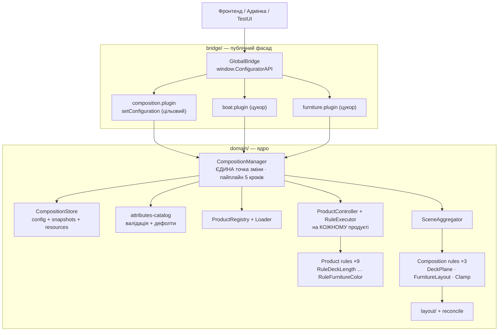
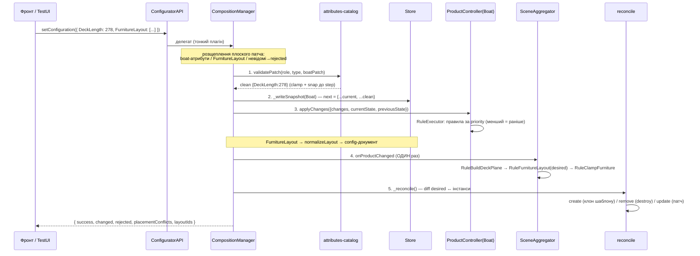

# Онбординг розробника — Bimini Boat Configurator

> PlayCanvas-конфігуратор понтонного катера (Bimini). Документ для входження нового
> розробника: від першого запуску до самостійної розробки правил і фіч. Описує **те, що є
> зараз у коді** (`src/Scripts/app-configuration/`, 52 .mjs) — як воно працює і як усе
> рухається, включно з новою декларативною моделлю `setConfiguration`.
>
> Це прямий спадкоємець онбордингу Hasting, але переписаний під реальну архітектуру Bimini:
> прибрано cabinet-специфіку (dividers/drawers/mesh-boolean/overlays), лінійний layout
> замінено на `DeckPlane` + `FurnitureLayout`, а «дві точки зміни стану» Hasting виправлено
> на єдиний пайплайн `setConfiguration → … → reconcile`.

**Читай супутні доки в цьому порядку:** `CLAUDE.md` (інваріанти) → `docs/CONTEXT.md`
(хендовер) → `docs/BIMINI_ARCHITECTURE.md` (design-doc) → `docs/CONFIGURATION_CONCEPT.md`
(модель конфігурації) → `docs/API_CONTRACT.md` (контракт) → `docs/ARCHITECTURE_REVIEW.md`
(ревʼю, ризики, борг).

---

## 0. Що це за продукт

3D-конфігуратор понтонного катера на **PlayCanvas**, який рендериться у вкладці браузера
і керується ззовні через `window.ConfiguratorAPI`. Бекенда, БД і авторизації **немає** —
уся система живе в памʼяті сторінки; конфіг — джерело правди, PlayCanvas — «вʼювер».

Три класи обʼєктів:

- **Boat** (`Boat_PC_Config`) — один параметричний продукт (`role: 'platform-parametric'`):
  лодка + дека + двигун + **забір як підзбірка**. Керується ~9 атрибутами (розміри деки/
  забору, типи забору front/back, кольори). Розміри деформують меші через SmartStretch.
- **Fence (забір)** — НЕ окремий продукт, а параметрична підзбірка лодки (`boat_fence_moove1/2/3`
  + variant-меші round36/round/square). Єдина роль назовні — задавати межі площини палуби.
- **Furniture (меблі/дивани)** — N окремих `draggable`-продуктів на палубі (Chaise,
  Corner3232[Wcup], PontoonBench30/36/50, HelmStand, RockportHelms, BucketSeat, PontoonArm L/R,
  CupHolder), кожен у кольорі Beige/Grey. Склад меблів описано масивом `FurnitureLayout`.

Головна ідея архітектури — **декларативні правила**. Ти майже ніколи не пишеш «зроби X із
мешем напряму». Ти пишеш правило, яке *слухає* зміну атрибута (`DeckLength`, `FenceColor`…)
і реагує. Рушій сам вирішує, коли й у якому порядку його запустити.

---

## 1. Ментальна модель за 5 хвилин

Дані течуть згори вниз, **односпрямовано**: `config → rules (чисті функції) → scene`.



Чотири шари:

| Шар | Файли | Роль |
|---|---|---|
| **Bridge** | `bridge/` | Тонкий публічний фасад `window.ConfiguratorAPI`. Лише делегує в CM. |
| **Domain** | `domain/` | Ядро: стор, оркестратор, правила, каталог, registry. Уся логіка тут. |
| **Services** | `services/` | Матеріали, логер, розмірні лінії, камера, AR-експорт. |
| **Helpers** | `helpers/` | Чиста механіка: пошук entity, transform, інтерполяція keyframes. |

Два рівні правил, які треба чітко розрізняти:

| Рівень | Хто виконує | Про що | Приклад |
|---|---|---|---|
| **Product rules** | `RuleExecutor` на кожному продукті | Зміни *всередині* одного продукту | Розтягнути деку на нову довжину, перефарбувати забір |
| **Composition rules** | `SceneAggregator` | Взаємодія *між* продуктами | Побудувати `DeckPlane` з габаритів лодки, розкласти й приклампити меблі |

Правило спрацьовує коли: **змінився атрибут, який воно слухає** (`watchAttributes` для product
rules / `watchParams` для composition rules), і `shouldExecute()` повернув `true`.

**Ключовий інваріант (виправлення антипатерну Hasting):** правила — чисті функції «стан →
бажаний результат». Вони **ніколи не створюють і не видаляють entity/продукти**. Усі
структурні мутації (клон шаблону дивана, `destroy`) — тільки в кроці **reconcile** самого
`CompositionManager`.

---

## 2. Життєвий цикл одного `setConfiguration`

Це найважливіша діаграма в проєкті. Вивчи її — і 80% багів стають прозорими.



Пʼять кроків пайплайну (усе в `CompositionManager.setConfiguration`, `domain/composition/composition-manager.mjs`):

1. **validate** — `validatePatch(role, type, patch)` за `attributes-catalog`: number → clamp
   до `[min,max]` + snap до `step`; enum → значення ∈ `values`; структурні
   (`position`/`rotationY`/`type`/`layoutId`/`positionMode`) → passthrough; невідомі → у
   `rejected` (warn).
2. **store** — запис у `CompositionStore`: boat → `_writeSnapshot` (`next = {...current, ...clean}`);
   `FurnitureLayout` → `normalizeLayout` → конфіг-документ (shallow-replace цілим масивом).
3. **product rules** — `_runProductRules` → `ProductController.applyChanges` → `RuleExecutor`
   виконує правила продукту **послідовно за priority**.
4. **composition rules** — `_fireAggregation` → `aggregator.onProductChanged` **один раз** →
   `RuleBuildDeckPlane` → `RuleFurnitureLayout` (пише derived `FurnitureLayout:desired`) →
   `RuleClampFurniture`. Composition rules **чисті**: лише обчислюють derived-ресурси в store.
5. **reconcile** — `_reconcile()` diff-ить бажаний layout ↔ фактичні інстанси по стабільних
   id: **create** (клон шаблону + `productController` + product rules), **remove** (`destroy`),
   **update** (патч снапшоту + позиція/ротація + product rules). **ЄДИНЕ місце структурних мутацій.**

**Batch** = багато ключів в одному патчі: кроки 1–3 на кожному ключі/продукті, кроки 4–5 —
один раз у кінці. Окремого «batch»-методу не існує.

**Пріоритет інвертований:** менший номер = виконується першим (`rules.sort((a,b) => a.priority - b.priority)`).
Контрінтуїтивно — запамʼятай.

---

## 3. Локальний запуск і перший контакт

Bimini синкається у PlayCanvas Editor через **playcanvas-sync** (GitHub Action пушить папку
`Scripts/`). Локальний dev — це bridge-сервер, що підміняє URL скриптів у Launch-режимі
редактора, щоб не пушити на кожну зміну.

### Dev-сервер (hot-reload у Launch)

```bash
cd src
pnpm install          # express, cors, chalk
pnpm dev              # node tools/server.js — Express + HTTPS :3000 (mkcert-сертифікати)
```

Сервер віддає `/file-map` + `/src/*`; у Launch-режимі PlayCanvas додай до URL `?local=true` —
хук підмінить URL скриптів на локальні. Прапорці комбінуються:

| URL-прапорець | Що вмикає |
|---|---|
| `?local=true` | Hot-reload скриптів з локального dev-сервера (:3000) |
| `?testui` | Dev-панель усіх атрибутів (слайдери/дропдауни) — `modules/test-ui` |
| `?stretchlog` | Діагностика SmartStretch (логи розтягу мешів) |

Приклад: `https://launch.playcanvas.com/<scene>?local=true&testui&stretchlog`.

> Точні шляхи до проєкту в редакторі, PlayCanvas-креденшали (`PC_API_KEY`, `PC_PROJECT_ID`,
> `PC_BRANCH_ID`) і процес публікації — у `src/README.md` та у тімліда (Andriy).

### Перший контакт з консолі

Відкрий **консоль браузера** — це твоя головна робоча поверхня. Перевір, що API живе:

```js
window.ConfiguratorAPI            // має бути обʼєктом
pc.app.compositionManager          // центральний оркестратор
ConfiguratorAPI.getConfiguration() // поточний конфіг-документ
```

Зміни щось і подивись, як тече лог:

```js
// ЦІЛЬОВИЙ шлях — один метод, плоский патч:
await ConfiguratorAPI.setConfiguration({
    DeckLength: 278,
    FenceColor: 'Navy',
    FurnitureLayout: [
        { type: 'Corner3232', position: { x: 0.3, z: 1.2 }, color: 'Beige' },
        { type: 'PontoonBench', size: 50 }   // без id → згенерується, повернеться в layoutIds
    ]
});
// → { success, changed:['DeckLength','FenceColor','FurnitureLayout'], rejected:[], placementConflicts:[], layoutIds:[...] }

// ЦУКОР (сумісність з адмінкою):
await ConfiguratorAPI.setBoatConfig({ DeckLength: 240, FenceTypeFront: 'square_fence_front' });
const id = await ConfiguratorAPI.addFurniture('PontoonBench', { Size: 36 });
await ConfiguratorAPI.setFurnitureConfig(id, { FurnitureColor: 'Beige' });
```

Невалідні/чужі ключі тихо відкидаються з warn (напр. `DeckLength` для furniture,
`FenceColor:'Purple'`), решта патча застосовується.

---

## 4. Дебаг-точки в консолі (щоденний інструмент)

```js
// Стан
pc.app.compositionManager                             // оркестратор
pc.app.compositionManager.getActiveComposition()      // CompositionStore
pc.app.compositionManager.getConfiguration()          // конфіг-документ (boat attrs + FurnitureLayout)
pc.app.compositionManager.getActiveComposition().serialize()  // повний зліпок стану
pc.app.compositionManager.aggregator                  // SceneAggregator (composition rules)

// Пошук сутностей
pc.app.root.findByName('Boat_PC_Config')
pc.app.root.findByName('fl-pontoonbench-1')           // інстанс дивана (імʼя = стабільний id)
entity.script.productController                        // хост правил на продукті
entity.script.smartStretch                            // компонент розтягу (на deck-панелях)
```

Фільтруй консоль за ключем (`LoggerService` логує все з префіксами):

- `[CompositionManager]` — життєвий цикл, `setConfiguration`, reconcile
- `[RuleExecutor]` — виконання product rules (і помилки в них)
- `[SceneAggregator]` — composition rules
- `[ProductController]` — реєстрація правил на продукті (тип → N rules)
- `[GlobalBridge]` — `ConfiguratorAPI exposed`
- `[TestUI]` — dev-панель
- `?stretchlog` — окрема діагностика SmartStretch

Внутрішні події (fire-and-forget): `bridge:ready`, `deckPlane:updated`, `placement:conflicts`.

---

## 5. Як налагоджувати типові поломки

**Меш не оновлюється після `setConfiguration`:**
1. Ключ пройшов валідацію? Перевір, що він у `changed`, а не в `rejected` результату.
2. `watchAttributes` правила містить змінений атрибут? `shouldExecute()` повертає `true`?
3. Правило зареєстроване для цього типу продукту в `product-config-loader.mjs`?
4. `SceneEntityHelper.collectByNames(this.entity, targets)` знаходить сутності (імена з `bindings`)?
5. На deck-сутностях є компонент `smartStretch`? (розтяг пише саме туди).

**Меблі не зʼявляються / не зникають:**
1. Елемент є у `FurnitureLayout` конфіг-документа? (`getConfiguration().FurnitureLayout`).
2. У сцені існує **прихований шаблон-entity з іменем = `type`** (напр. `PontoonBench`)?
   Без шаблону reconcile лише додасть у store і залогує warn (`no template entity`).
3. `diffLayout` дав правильний diff? Перевір стабільні id (нові → create, зниклі → remove).
4. Після клону навісився `productController`? (reconcile робить `entity.script.create(ProductController)`).

**Меблі стоять не там / вилазять за палубу:**
1. `DeckPlane` порахований? (`RuleBuildDeckPlane` спрацював, `deckPlane:updated` стрельнув).
2. `RuleFurnitureLayout` reflow-нув позиції? (reflow «один за одним» із захардкодженого `layout/layout-data.mjs`).
3. `RuleClampFurniture` не дав `placementConflicts`? (елементи, що не влізли, — у результаті).
4. `FURNITURE_FOOTPRINTS` відкалібровані під реальні меші? (зараз плейсхолдери — blocked by client).

**Забір не фарбується (юніпи):**
- Відомий баг: `FenceColor.targetGlobs` не матчить `fence_unip_*_plane`. Фікс на 1 рядок,
  ще не застосований за рішенням власника (див. §11).

---

## 6. Верифікація змін (тестів поки немає)

**Автоматичних тестів і CI зараз немає** (0 юнітів, `package.json` має лише `dev`). Тому
верифікація — ручна + синтаксична. Мінімальний цикл після кожної зміни .mjs:

```bash
# 1. Синтаксис кожного зміненого файлу:
node --check src/Scripts/app-configuration/domain/product/rules/boat/RuleDeckLength.mjs

# 2. Для кросфайлових змін — перевір, що relative-імпорти резолвляться
#    (жодного циклу; імпорт-граф чистий — це перевірялось скриптом резолву).
```

Далі — візуальна перевірка в Launch (`?testui` + `?stretchlog`): проженеш слайдери
розмірів, звіриш геометрію, для параметрики — зафіксуй еталонні скріни (калібрування
SmartStretch зроблене реверс-інжинірингом і **потребує візуальної верифікації**).

> **Рекомендація з ARCHITECTURE_REVIEW §10:** чиста логіка (`validatePatch`, `normalizeLayout`,
> `diffLayout`, `KeyframeHelper.interpolate`) тривіально покривається vitest — це найдешевший
> перший крок до тестів. Якщо додаєш нову чисту функцію — напиши до неї юніт.

---

## 7. Як написати нове правило

Це основна одиниця роботи розробника. Є **два види** правил.

### 7a. Product rule (зміна всередині продукту)

Скелет (дивись сусідів у `domain/product/rules/boat/` та `.../furniture/`):

```js
import { BaseProductRule } from '../../../../core/rule/base-product-rule.mjs';
import { SceneEntityHelper } from '../../../../helpers/scene-entity-helper.mjs';
import { SceneTransformHelper } from '../../../../helpers/scene-transform-helper.mjs';

export class RuleMyThing extends BaseProductRule {
    constructor() {
        super({
            name: 'RuleMyThing',
            watchAttributes: ['MyAttr'],   // на які зміни реагувати
            priority: 25                    // де в черзі (менший = раніше)
        });
    }

    onInitialize() {
        // доступні: this.app, this.entity, this.productId (через context)
    }

    // базовий клас уже перевіряє watchAttributes; перевизначай лише для додаткової логіки
    // shouldExecute(changes, currentState, previousState) { return super.shouldExecute(...); }

    execute({ changes, currentState, previousState }) {
        const value = changes.MyAttr;
        // знайти сутності й застосувати матеріал / розтяг / видимість
        for (const e of SceneEntityHelper.collectByNames(this.entity, ['Some_Mesh'])) {
            SceneTransformHelper.applyTransformFn(e, 'StretchX', value);
        }
    }
}
```

Правила виконуються **послідовно**, помилки ловляться **на рівні кожного правила** окремо
(`RuleExecutor._run` обгортає `try/catch`) — падіння одного не зупиняє решту. Зареєструй
клас у реєстрі продукту — `domain/product/registry/product-config-loader.mjs` (масив `rules`
відповідного типу). `ProductController` підхопить його автоматично за типом entity.

**Патерн параметричних правил (розміри Boat):** кожен розмірний атрибут = **окреме правило**,
що слухає лише свій атрибут і бере свій слайс `parametric/bindings.mjs`. Механіка —
у хелперах: `KeyframeHelper.interpolate(keyframes, x, mode)` (lerp/step) →
`SceneEntityHelper.collectByNames` → `SceneTransformHelper.applyTransformFn(entity, fn, value)`
(`MoveX/Z` через композицію offset-ів, `StretchX/Z` через патч осі smartStretch — правила не
затирають одне одного). Приклад — `RuleDeckLength.mjs` (пріоритет 10).

Наявні product rules і їхні пріоритети:

| Правило | watch | priority | Що робить |
|---|---|---|---|
| `RuleDeckLength` | DeckLength | 10 | Розтяг деки по Z + move fence/engine |
| `RuleDeckWidth` | DeckWidth | 10 | Розтяг деки по X |
| `RuleFenceLength` | FenceLength | 10 | Параметрика забору по довжині |
| `RuleFenceWidth` | FenceWidth | 10 | Параметрика забору по ширині |
| `RuleFrontIndent` | FrontIndent | 10 | Передній відступ |
| `RuleFenceType` | FenceTypeFront, FenceTypeBack | 20 | Enable variant-меша + disable сіблінгів |
| `RuleBoatMaterial` | DeckColor, FenceColor | 30 | Матеріал деки/забору |
| `RuleFurnitureVariant` | Size | 20 | Свап variant-меша дивана (PontoonBench) |
| `RuleFurnitureColor` | FurnitureColor | 30 | Матеріал дивана (submesh→material) |

Boat і Furniture — різні набори: перші 7 живуть на `Boat_PC_Config`, останні два — на
кожному furniture-інстансі (розподіл — у `product-config-loader.mjs`). Розмірні правила
всі мають `priority: 10` (взаємно незалежні осі), потім variant/type (20), потім матеріали (30).

### 7b. Composition rule (взаємодія між продуктами)

Успадковують `BaseCompositionRule` (`domain/composition/rules/base-composition-rule.mjs`),
експонують `toHandlerConfig()` (`watchParams`, `aggregateFn`, `applyFn`) і реєструються в
`SceneAggregator` через `CompositionManager.registerCompositionRule(rule)` у bootstrap
(`SceneManager`). **Порядок реєстрації визначає порядок виконання:**
`RuleBuildDeckPlane` → `RuleFurnitureLayout` → `RuleClampFurniture`.

**Критичний інваріант:** composition rule **чиста** — лише обчислює derived-ресурс і кладе
його в store (`DeckPlane`, `FurnitureLayout:desired`). Створення/видалення інстансів — НЕ тут,
а в `CompositionManager._reconcile`.

---

## 8. Карта файлів (де що лежить)

Корінь коду: `src/Scripts/app-configuration/`.

**Ядро:**

| Шлях | Призначення |
|---|---|
| `bridge/global-bridge.mjs` | Точка входу, віддає `window.ConfiguratorAPI` |
| `bridge/plugins/composition.plugin.mjs` | `setConfiguration` / `getConfiguration` (цільовий контракт) |
| `bridge/plugins/boat.plugin.mjs`, `furniture.plugin.mjs` | Цукор-делегати (сумісність з адмінкою) |
| `domain/composition/composition-manager.mjs` | **Центральний оркестратор** — пайплайн 5 кроків + reconcile |
| `domain/composition/composition-store.mjs` | Стан: config-документ, snapshots, shared resources; `serialize()` |
| `domain/composition/scene-aggregator.mjs` | Рушій composition rules з чергою |
| `domain/composition/rules/RuleBuildDeckPlane.mjs` | Boat габарити → `DeckPlane` |
| `domain/composition/rules/RuleFurnitureLayout.mjs` | Reflow «один за одним» → `FurnitureLayout:desired` |
| `domain/composition/rules/RuleClampFurniture.mjs` | Кламп меблів у `DeckPlane` → `placementConflicts` |
| `domain/composition/layout/furniture-layout.mjs` | Схема, `normalizeLayout`, `diffLayout`, `generateLayoutId` |
| `domain/composition/layout/layout-data.mjs` | Захардкоджені footprints/розкладка (TODO: `layouts.json`) |
| `domain/product/controller/product-controller.mjs` | Script на КОЖНОМУ продукті (Boat + кожен Furniture) |
| `domain/product/rules/rule-executor.mjs` | Послідовний рушій правил + черга |
| `core/rule/base-product-rule.mjs` | База product rules (порт 1:1) |
| `domain/product/rules/boat/*`, `furniture/*` | 9 product rules (файл-на-атрибут) |
| `domain/product/registry/product-registry.mjs` (+ `product-config-loader.mjs`) | Тип → { role, rules, defaultConfig }; `detectProductType` |
| `domain/product/attributes/attributes-catalog.mjs` | **Єдине джерело** атрибутів: enum/number, `validatePatch`, `defaultsForRole` |
| `domain/product/parametric/bindings.mjs` (+ `.json`) | Data-driven параметрика з Rules1 (keyframes) |
| `domain/scene/manager/scene-manager.mjs` | **Bootstrap**: створює CM, реєструє composition rules, drag, testui |

**Сервіси:** `services/material/` (load+кеш+дедуп), `services/logger/`, `services/dimension/`
(LineDimension), `services/camera/`, `services/cameraFraming/`, `services/ar-export/`
(GLB/USDZ — *не інтегровані в bootstrap*).

**Хелпери:** `helpers/scene-entity-helper.mjs` (`collectByNames`, `traverseAabb`),
`scene-transform-helper.mjs` (`applyTransformFn`, `setStretch`, `waitForFrames`),
`keyframe-helper.mjs` (`interpolate`), `mesh-rule-config-builder.mjs`, `download-helper.mjs`.

**Модулі:** `modules/test-ui/` (dev-панель за `?testui`), `modules/drag-movement/`
(**заготовка фази 2** — у публічний контракт не входить).

**Опорні:** `docs/*` (доки), `reference/BiminiBoatConfig.xlsx` (Rules1 — джерело bindings),
`reference/BiminiBoat_playcanvas_export.zip` (експорт сцени з іменами entity),
`src/ENTITIES_MAP.md` (карта сутностей), `reference/hasting/` (референс по ядру).

---

## 9. Підсистеми, які треба знати (стисло)

- **Параметрика (bindings).** `parametric/bindings.mjs` — data-driven таблиця з `Rules1`:
  кожен binding = `{ variable, fn (Move*/Stretch*), targets[], keyframes[{at,value}] }`.
  `at` — дюйми (UI), `value` — метри/юніти сцени; `mode: 'lerp'|'step'`. Product rule читає
  свій слайс і застосовує через хелпери. ⚠️ У bindings є **каліброві FIX-и** (напр.
  `deck_stretch` ×2, recenter), яких **немає в Rules1** — вони живуть лише тут; наступна
  регенерація з xlsx їх затре, якщо не занести в генератор (борг §11).
- **SmartStretch** — CPU-деформація меша (9-slice-подібна): краї зсуваються назовні, центр
  масштабується. Компонент `smartStretch` навішено на deck-панелі; параметричні правила
  пишуть у нього вісь розтягу через `SceneTransformHelper`. Після клону — `waitForFrames`.
- **DeckPlane (mediator).** Забір і меблі прямо НЕ звʼязані. Boat продюсить `DeckPlane`
  (`RuleBuildDeckPlane` з габаритів деки+забору), drag-модуль/меблі споживають
  (`RuleClampFurniture`). Меблі — НЕ дочірні до забору.
- **FurnitureLayout + reconcile.** Масив елементів `{id, type, position, rotationY, color?,
  size?, positionMode}` — «що стоїть на палубі». `id` стабільний (патерн React keys).
  `diffLayout` → create/remove/update; **інстанціювання = клон прихованого шаблону** (імʼя =
  `type`). Reflow позицій зараз derived із захардкодженого `layout-data.mjs` (blocked by client).
- **MaterialService** — async `load` + кеш + дедуплікація pending-Promise-ів + `waitForTextures`
  + batch `applyMaterialByName`; ініціалізується в SceneManager. Правила, що залежать від
  застосованого матеріалу, мають `await`.
- **Drag-модуль (фаза 2, заготовка).** `DragMovementModule` + `DragPlaneCalculator` +
  `MovementController`. Зараз пише в стор напряму (порушення one-way — свідомий борг); у
  публічний контракт не входить. Майбутнє: `positionMode: 'manual'` + запис у config один раз на drop.

---

## 10. Пастки, на яких новачки горять

1. **Пріоритет інвертований**: менший `priority` = виконується раніше.
2. **Правила НЕ створюють/видаляють entity.** Будь-яка структурна мутація — тільки в
   `_reconcile`. Порушиш — зламаєш інваріант «One Way to Change State».
3. **Посилання на сутності після `clone()` НЕ ремапляться** PlayCanvas-ом — це джерело багів
   при клонуванні шаблонів меблів; синхронізуй через імена/reconcile, не через збережені refs.
4. **SmartStretch на клоні** не працює одразу — потрібні кадри (`waitForFrames`).
5. **Матеріали вантажаться асинхронно** — правила, що залежать від застосованого матеріалу,
   мають `await` (MaterialService дедуплікує, але не синхронний).
6. **`FurnitureLayout` шлеться цілим масивом** (read-modify-write на UI). Не шли частковий —
   семантика shallow-replace по top-level ключу затре решту.
7. **Один шаблон-entity на `type`** має існувати у сцені (прихований), інакше reconcile лише
   залогує warn і продукт житиме тільки в store.
8. **bindings ≠ Rules1 один-в-один**: у bindings є ручні FIX-и калібрування. Не «виправляй»
   їх назад до Rules1, не зрозумівши нотатки в самому binding.
9. **`?stretchlog`** — твій друг для будь-якого багу геометрії розмірів.

---

## 11. Відомі баги та технічний борг (стан на 2026-07-05)

Джерело — `docs/ARCHITECTURE_REVIEW.md` §9. Пріоритезовано.

| # | Пункт | Рівень | Суть |
|---|---|---|---|
| 1 | **git без комітів** | Critical | Уся робота лише на диску + PlayCanvas. Перший коміт + приватний remote — негайно. |
| 2 | **0 тестів / 0 CI** | High | Регресії калібрувань видно лише очима. Дія: vitest на чисту логіку + `node --check` у pre-commit. |
| 3 | **Параметрика не верифікована візуально** | High | SmartStretch ×2 / recenter зроблені реверс-інжинірингом. Дія: еталонні скріни зі `?stretchlog`. |
| 4 | **`FenceColor` не фарбує `fence_unip_*_plane`** | High | `targetGlobs` не матчить юніпи. Фікс на 1 рядок, не застосований за рішенням власника. |
| 5 | Мертві дані в bindings (`variants`, `materials.options`) | Medium | Рішення видалити ухвалене, не виконане. |
| 6 | `generateLayoutId` не переживає reload | Medium | Лічильник у памʼяті → колізії при майбутній персистентності. Фікс: uuid/суфікс сесії. |
| 7 | `RuleFenceWidth._ensureSmartStretch` навішує скрипт за стрінгою | Medium | Базові позиції можуть захопити вже зсунуту геометрію — перевірити. |
| 8 | Drag-заготовка пише в стор повз пайплайн | Medium | Свідомий борг фази 2 — перепишеться через `setConfiguration`. |
| 9 | Неінтегровані Hasting-сервіси (camera, ar-export, dimension) | Medium | Мертвий вантаж до інтеграції; можлива cabinet-специфіка/транспіляція. |
| 10 | `_fireAggregation` збирає conflicts через тимчасовий event-handler | Low | Крихко, якщо кілька джерел стрельнуть разом. Дія: повертати conflicts значенням. |
| 11 | `FURNITURE_FOOTPRINTS` / `layout-data` — плейсхолдери | Low | Blocked by client (формат розкладок). |

**Головна залежність-контекст:** формат таблиці розкладок і поняття «пакет комплектації» —
**blocked by client**; це блокує винесення `layout-data.mjs` → `layouts.json`. Архітектурно
ізольовано (rule + data), тож клієнтська зміна не зачепить пайплайн.

---

## 12. Чек-лист «я готовий працювати самостійно»

- [ ] Підняв dev-сервер (`pnpm dev`), відкрив Launch із `?local=true&testui`, `ConfiguratorAPI` відповідає в консолі.
- [ ] Зібрав конфіг через `setConfiguration`, змінив розмір деки й колір забору, побачив реакцію сцени.
- [ ] Додав і прибрав диван через `FurnitureLayout` (перевірив reconcile у логах `[CompositionManager]`).
- [ ] Прочитав лог одного `setConfiguration` від валідації до reconcile.
- [ ] Розумію різницю між product rule (`RuleExecutor`) і composition rule (`SceneAggregator`).
- [ ] Розумію інваріант «правила чисті, структурні мутації — тільки в reconcile».
- [ ] Написав тестове product rule-заглушку, зареєстрував у `product-config-loader`, побачив у `[ProductController]`/`[RuleExecutor]`.
- [ ] Прогнав `node --check` на змінених .mjs; переконався, що імпорти резолвляться.
- [ ] Знайшов і зрозумів один із багів §11 (напр. #4 глоб `fence_unip_*_plane`).
- [ ] Прочитав `CLAUDE.md`, `docs/CONFIGURATION_CONCEPT.md`, `docs/API_CONTRACT.md`, `docs/ARCHITECTURE_REVIEW.md`.

---

*Питання по конкретних шляхах у редакторі, PlayCanvas-креденшалах і процесі публікації —
до тімліда (Andriy). Цей документ покриває архітектуру, поточний стан і методологію;
інфраструктурні деталі специфічні для команди.*
